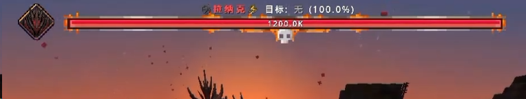

# 自定义 BossBar 约定

2026-11-01 修订。本文约定 WebUI 文件、客户端显示和服务端变量包。当前先完成 WebUI，游戏接入另行实施。

`.bossbar` 是客户端资源。服务端计算进度、文本和显隐所需的变量，向有权观看的玩家发送实例状态。客户端读取本地模板、绑定收到的变量并绘制。PNG、组件、文字排版和多条血条的排列都由客户端处理。



## 文件和组件

源文件放在 `src/bossbars/<文件名>.bossbar`。格式为 `hanshu.bossbar`、`version:2`，字段如下。

| 字段 | 约定 |
| --- | --- |
| `id` | 模板 ID，区分大小写，最长 128 字符，禁止首尾空白和控制字符 |
| `priority` | int32，省略时为 0；数值越大，多条排列时越靠上 |
| `texture` | 唯一 PNG 的纯 Base64，不带 data URL 前缀或空白 |
| `layout` | 顶部居中布局，`scale` 为 0.1–4，`safeMargin` 为 0–1024 GUI 像素 |
| `variables` | 服务端变量的名称、四种类型和默认值 |
| `components` | 一个 `display_region`，加任意数量的 `background`、`bar`、`text` |

作者输入必须提供 `format/version/id/texture/layout/variables/components`，`variables` 可以为空对象。`priority` 可省略，`layout:{}` 会补齐顶部居中、scale=0.5、safeMargin=12。规范编译输出显式写出 priority 和各字段默认值。未知字段、未知版本和旧版 v2 草稿中的已删除字段都给出诊断，保留原始草稿。v1 文档通过显式升级生成 v2，模板 ID 保持原值。

编辑画布可无限平移、缩放，坐标允许负数和小数。唯一显示区域决定整个模板的外框，所有组件的完整 `box` 必须位于区域内，四边相切合法。隐藏图层、空血条和透明像素不改变包含判断。每个组件的输出，包括阴影和尾条，都裁切在自身 box 内。

可绘制组件共有 `visible` 和 `opacity`：前者为 bool 常量或 bool 变量引用，默认为 true；后者为 0–1，默认为 1。数组顺序就是绘制顺序。显示区域只包含 `id/type/box`，不能复制、删除或增加第二个。单独修改显示区域不带动其他组件；会使组件越界的修改拒绝提交。“整体移动”同时平移区域和全部组件，保留相对坐标，作为一步撤销。“适配到全部组件”由作者主动执行。

## 条、文本和变量

数值条只接收服务端已经算好的进度，`progress` 为有限数值或 `{"var":"变量名"}`。变量引用必须指向 `double`。绘制时把进度夹紧到 `[0,1]`，模板不保存 value/min/max 范围，也不计算血量比例。四个方向、主条平滑和尾条仍是客户端的显示效果；纹理先映射到完整 box，再按进度裁切，剩余血量不会压缩图案。

文本的 `runs` 只有两种形状：`{"text":"字面文本","color":"#RRGGBBAA"}`、`{"var":"变量名","color":"#RRGGBBAA"}`，颜色可省略。变量按原值转为文本：string 原样使用，long 保留完整十进制字符串，double 使用数值字符串，bool 显示 `true/false`。模板不含比例片段、数字格式、精度或本地化规则。千分位、百分号、缩写和译文需要由服务端准备为 string 后发送。

变量名就是包中 `values` 的键，不另设字段别名。变量仍支持 long、double、bool、string。JSON 中 long 使用 int64 范围内的十进制字符串，double 必须有限，string 的 `maxLength` 为 1–256 Unicode 码点。缺失、类型不匹配或超长时，客户端使用声明默认值并记录原因。bool 不作为数值使用。变量名和组件 ID 满足 `[A-Za-z][A-Za-z0-9_]{0,63}`，各自在声明范围内唯一。

下面的片段可直接看出服务端和模板各自提供什么。服务端先准备 `healthProgress:0.35` 和 `healthText:"42万 / 120万（35%）"`，模板只绑定进度和显示字符串。

```json
{
  "priority": 10,
  "variables": {
    "healthProgress": {"type":"double","default":1},
    "healthText": {"type":"string","default":"120万 / 120万（100%）","maxLength":64}
  },
  "components": [
    {"id":"region","type":"display_region","box":{"x":0,"y":0,"width":320,"height":32}},
    {"id":"health","type":"bar","box":{"x":0,"y":16,"width":320,"height":16},"progress":{"var":"healthProgress"},"fill":{"kind":"solid","color":"#E84032FF"}},
    {"id":"label","type":"text","box":{"x":0,"y":0,"width":320,"height":16},"runs":[{"var":"healthText"}]}
  ]
}
```

这是省略 `format/version/id/texture/layout` 的字段示例。完整可打开文件在 `demo-projects/bossbar-demo/src/bossbars/`，包含参考构图和简单条两份模板。演示中的默认值让模板在没有游戏连接时也能看到血条、护盾和文字。

## 图集和动画

所有图像组件共用文档内唯一的 PNG。UV 使用图集像素坐标 `x/y/width/height`，为整数并完整落在图集内。采样使用最近邻，夹紧到当前 UV，避免相邻图块串色。背景支持 stretch、contain、cover、nine-slice；条填充只用 stretch。九宫格边距相对 UV，目标过小时同比缩小边距。

动画只切换源 UV，组件 box 恒定。`paint.uv` 等于第一帧，所有帧尺寸相同，每帧 16–60000ms，最多 256 帧。loop 循环，once 停在末帧，pingpong 不重复端点；相位为非负整数。客户端用实例时间取帧，变量更新不重启动画，卡顿后直接取当前帧。

上传或粘贴 PNG 时规范化 Base64，并检查 CRC、压缩流、像素长度和资源预算。替换图集保留 UV 后重新校验，越界时拒绝替换。图集替换、帧修改和撤销都作用于同一份文件，不生成外链图片或图集清单。

## 服务端变量包

以下是后续游戏接入的契约，当前 WebUI 不要求连接游戏。服务端持有实例与变量，接收者来自玩家的实际追踪关系；服务端不读取 PNG、组件或客户端模板，不执行渲染，也不计算模板排版。脚本先完成比例计算、本地化和显示字符串拼接，再更新需要同步的变量。发包方只需知道模板 ID 和约定的变量字段。

通道版本为 `bossbar-1`。每个连接使用独立 `connectionEpoch` 和单调递增 `seq`；断线或切换连接时客户端清空实例、序号和未完成批次。实例使用 UUID，重建会话使用新 UUID，不能拿模板 ID 当作实例身份。

| 消息 | 必要内容 |
| --- | --- |
| `UPSERT` | instanceId、templateId、visible、startTick、sampleTick、带类型标签的完整 values；替换原版条目时附 vanillaEventId |
| `REMOVE` | instanceId、reason |
| `REPLACE_ALL` | sampleTick、当前允许该玩家观看的实例集合 |

`values` 携带 long/double/bool/string 类型，JSON 里的 long 仍为十进制字符串。每次 UPSERT 是完整变量快照，未声明字段忽略，缺失字段按客户端声明回退。包不包含纹理、组件、客户端布局或优先级；优先级来自本地模板。模板不可用时保留对应原版血条，不能隐藏整个原版 BossBar 层。

单条 UPSERT 最多 32KiB，变量声明按 30KiB 最坏快照预算校验。每个玩家最多保留 16 个实例，每实例更新默认最多 10 次/秒；首次出现、显隐和移除立即发送。REPLACE_ALL 最多 512KiB，按不超过 32KiB、最多 32 片组装，片段携带 batchId/partIndex/partCount，2 秒超时。客户端只采纳当前连接的新序号，整批验证后一次替换集合，离开追踪、切世界、退出或实例移除时清理对应状态。

## 客户端排列

客户端按模板 `priority` 降序排列多条 BossBar。同级按实例 UUID 的固定字节顺序升序，避免随接收顺序、距离或变量更新抖动。默认 priority 为 0，取值范围是完整 int32，不沿用旧草案的 -1000 至 1000 限制。

每条占用显示区域缩放后的实际高度，顶部留白 12、行距 6 GUI 像素。屏幕空间不足时按排序保留靠前条目，默认最多显示 3 条。移动整个设计到负坐标不改变相对区域的显示位置。客户端窗口、GUI 缩放或资源变化时重新计算排列。

## WebUI、保存和导出

设计和 JSON 编辑同一份草稿。中央只有一个编辑视口，变量模拟、播放、暂停、逐帧和时间轴直接作用于这个视口。相机、网格、参考底图、时间和模拟变量只属于本机编辑状态，不写进 `.bossbar` 或 PAK。属性栏编辑 priority、布局和组件，变量面板填写服务端字段声明及模拟值，图集面板编辑 PNG、UV 和动画。

设计修改通过校验后写回草稿；JSON 无效时保留原文和上次有效画面，暂停设计编辑。保存、携带脏正文改名和导出均校验文档，失败保留输入。图集与组件是同一个文件版本，经已有工程事务提交。只读成员可以模拟和查看，不能修改工程文档；版本冲突保留旧草稿。改名、删除和远端移除继续使用资源生命周期机制。

编译器输出 `bossbars/<文件名>.bossbar`，平面为 client。client 与 combined 包包含同一份规范 UTF-8 字节，server 包不含 BossBar 模板。规范输出补齐默认值并保留 priority，变量按名字排序；客户端对编译字节计算 SHA-256。跨包检查以最终有效路径为准，不同路径的同模板 ID 拒绝导出，同路径覆盖沿用包顺序。

文档最多 6MiB，PNG 压缩字节最多 4MiB、边长最多 4096、RGBA 解码内存最多 64MiB，非纹理元数据最多 256KiB。显示区域最大 4096×1024，最多 128 个可绘制组件和 64 个变量。超限给出错误，不以裁切或丢字段代替校验。

## 验收范围

`npm run test:bossbar` 检查协议、PNG、进度夹紧、原值文本、优先级边界、图集与帧工具、保存拦截及实际 PAK 内容。集成检查必须确认 server 包没有模板，client/combined 字节相同，模拟值没有进入产物。浏览器检查覆盖设计/JSON 往返、撤销、变量模拟、图集替换、逐帧、保存重开、只读和双窗口冲突。

WebUI 运行后保留可操作页面，等待用户验收。游戏阶段再实现变量包发送、追踪生命周期、客户端资源加载和多条排列，并以实际 Minecraft 客户端检查；本次简化不修改 Mod 代码。
